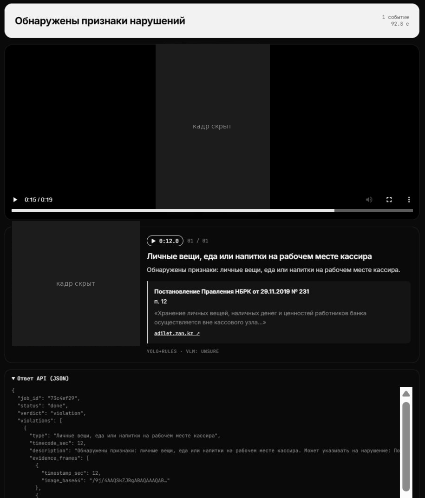

# pootis-solution

Сервис находит видимые нарушения кассовой дисциплины на записях камер кассового помещения. На выходе вердикт, таймкоды и кадры-доказательства.
Всё работает локально: без внешних AI API и без распознавания лиц.

**Демо:** _ссылка скоро будет_



_Кадры с камер скрыты: тестовые видео публиковать нельзя._

## Как устроено

```
видео -> YOLO (люди, деньги, сейф, счётная машинка, сумки) -> правила -> проверка Qwen3-VL -> вердикт + кадры
                                    \-> проверка по пикселям: дверь кассы оставлена открытой
```

- `perception/` - обучение YOLO (`train_yolo.py`), правила поверх детекций (`model.py`), проверка двери (`scene.py`)
- `vlm/` - Qwen3-VL через Ollama: подтверждает слабые события и пишет описание; в `taxonomy.json` типы нарушений и пункт нормативки для каждого
- `service/` - FastAPI: страница загрузки, очередь задач, REST API

Сильные правила (ушёл и оставил ценности, принял сумку без проверки, посторонний у стола, деньги прошлого клиента на столе, дверь открыта) дают вердикт сами.
Слабые (пересчёт руками, кассир ушёл с рабочего места) остаются, только если их подтвердил Qwen.

## Запуск

Нужно: Python 3.11+, видеокарта NVIDIA от 4 ГБ, [Ollama](https://ollama.com) 0.12.7+.

```bash
pip install -r service/requirements.txt
ollama pull qwen3-vl:2b
# обученные веса положить в weights/best.pt (или задать YOLO_WEIGHTS)
uvicorn service.app:app --host 0.0.0.0 --port 8000
```

На Windows: `start_service.bat`. Публичный адрес: `start_tunnel.bat` (Cloudflare quick tunnel).

Открыть `http://localhost:8000`. API-ключ печатается при старте и лежит в `service/.api_key` (или задать `API_KEY`).

## API

```bash
curl -X POST http://localhost:8000/api/v1/analyze -H "X-API-Key: $KEY" -F "file=@video.mov"
# {"job_id": "3f2a9c1e", "status": "processing"}

curl http://localhost:8000/api/v1/jobs/3f2a9c1e -H "X-API-Key: $KEY"
# {"job_id": "...", "status": "done", "verdict": "violation",
#  "violations": [{"type": "...", "timecode_sec": 44.2, "description": "...",
#                  "evidence_frames": [{"timestamp_sec": 44.2, "image_base64": "..."}]}]}
```

`status`: `processing` | `done` | `failed`. `verdict`: `violation` | `no_violation`.
Загруженное видео удаляется сразу после обработки.

## Настройки

| env | по умолчанию | |
|---|---|---|
| `YOLO_WEIGHTS` | `weights/best.pt` | веса YOLO |
| `VLM_MODEL` | `qwen3-vl:2b` | модель в Ollama |
| `VLM_BACKEND` | `ollama` | `none` = только правила |
| `DEADLINE_SEC` | `240` | лимит времени на видео, считается от загрузки |
| `MAX_WEAK_CHECKS` | `3` | вызовов Qwen на видео |

## Обучение и оценка

```bash
python perception/train_yolo.py train --from <weights>   # дообучение
python perception/train_yolo.py predict                  # детекции для perception/model.py
python perception/model.py                               # правила против разметки: TP/FP/FN/TN
```

## Ограничения

- Пересчёт руками рядом с работающей машинкой часто пропускается: модель на 2B не отличает его надёжно.
- Проверка двери рассчитана на то, что дверь в левой верхней части кадра.
- YOLO обучен на нескольких сотнях кадров с пары ракурсов, на новых помещениях и углах будет слабее.

## Пара слов от нас

Всё это собрано на обычном домашнем железе: одна видеокарта на 4 ГБ, YOLO дообучен на паре сотен кадров, а VLM самая маленькая (2B), потому что большая просто не влезает.
Модель не идеальна: что-то пропускает, где-то ошибается, это видно по разделу выше. Но мы честно выжали максимум из того, что было под рукой.
С нормальной видеокартой, моделью покрупнее (Qwen3-VL 8B и выше) и большей разметкой результат будет заметно лучше, архитектура это позволяет без переделки: достаточно поменять `VLM_MODEL` и веса YOLO.

## Лицензии

Ultralytics YOLO - AGPL-3.0. Qwen3-VL - Apache-2.0. FastAPI, OpenCV - свободные лицензии.
